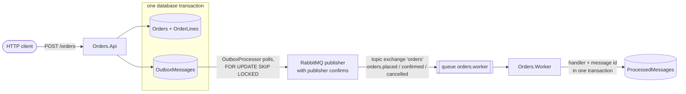

# Order Events Service

[](https://github.com/AdamBinAamir/order-events-service/actions/workflows/ci.yml)

A small ASP.NET Core (.NET 8) service that places orders, saves them to PostgreSQL, and publishes order events to RabbitMQ through a **transactional outbox**. A separate **idempotent worker** consumes the events. Integration tests run against real Postgres and RabbitMQ with **Testcontainers**, and the whole thing deploys to **Kubernetes** (kind).

## What it does

| Endpoint | Effect | Event |
| --- | --- | --- |
| `POST /orders` | Place an order (customer, lines with product, quantity, unit price, currency) | `OrderPlaced` |
| `GET /orders/{id}` | Fetch an order | |
| `POST /orders/{id}/confirm` | Confirm a pending order | `OrderConfirmed` |
| `POST /orders/{id}/cancel` | Cancel an order | `OrderCancelled` |
| `GET /health/live`, `/health/ready` | Liveness / readiness (database check) | |

Business rule violations (no lines, quantity ≤ 0, mixed currencies, confirming a cancelled order) return **400** as ProblemDetails; unknown orders return **404**.

## Architecture



```
src/
  Orders.Domain/          Order aggregate, OrderLine, Money value object, domain events. No framework references.
  Orders.Infrastructure/  EF Core (Npgsql), migrations, outbox, RabbitMQ connection and publisher.
  Orders.Api/             Minimal API endpoints, ProblemDetails, health checks, Swagger.
  Orders.Worker/          RabbitMQ consumer and idempotent event processor.
tests/
  Orders.Domain.Tests/        Unit tests for every domain rule and event.
  Orders.IntegrationTests/    Testcontainers: real Postgres + RabbitMQ, real API and worker.
deploy/
  k8s/                    Deployments, Services, ConfigMap.
  kind/kind-config.yaml   kind cluster config.
  smoke-test.sh           Places an order through a port-forward and checks the worker log.
```

## Run locally with docker-compose

Needs Docker and the .NET 8 SDK.

Everything in containers:

```bash
docker compose up --build
```

Or only the infrastructure, with the apps running from source:

```bash
docker compose up -d db rabbitmq
dotnet run --project src/Orders.Api      # http://localhost:5161/swagger
dotnet run --project src/Orders.Worker
```

The API applies EF Core migrations on startup (`Database:MigrateOnStartup`). To apply them by hand: `dotnet tool restore` and then `dotnet ef database update -p src/Orders.Infrastructure`.

Place an order (use port 8080 for the compose stack, 5161 for `dotnet run`):

```bash
curl -X POST http://localhost:8080/orders -H "Content-Type: application/json" \
  -d '{"customerId":"3f2504e0-4f89-11d3-9a0c-0305e82c3301","lines":[{"productId":"6f9619ff-8b86-d011-b42d-00c04fc964ff","quantity":2,"unitPrice":19.99,"currency":"EUR"}]}'
```

The worker logs `Order <id> placed by ...`. The message is visible in the RabbitMQ UI at http://localhost:15672 (guest / guest). [Orders.Api.http](src/Orders.Api/Orders.Api.http) has the full place / get / confirm / cancel flow.

## Run the tests

```bash
dotnet test
```

The integration tests start their own Postgres and RabbitMQ containers, so Docker must be running; no other setup is needed. They cover:

- placing an order writes the order row and exactly one outbox message;
- a cancelled order cannot be confirmed (400), invalid orders get 400, unknown ones 404;
- the worker handles an event **once** even when the same message is delivered twice;
- an order placed through the API flows outbox → RabbitMQ → worker end to end.

## Run on Kubernetes (kind)

Needs Docker, [kind](https://kind.sigs.k8s.io/) and kubectl.

```bash
kind create cluster --name orders --config deploy/kind/kind-config.yaml
docker build -f src/Orders.Api/Dockerfile -t orders-api:local .
docker build -f src/Orders.Worker/Dockerfile -t orders-worker:local .
kind load docker-image orders-api:local orders-worker:local --name orders
kubectl apply -f deploy/k8s
kubectl rollout status deployment/orders-api
bash deploy/smoke-test.sh
```

Or by hand: `kubectl port-forward svc/orders-api 8080:80`, post an order as above, and watch `kubectl logs -f deployment/orders-worker`.

CI runs this same flow on every push (job `kubernetes-smoke-test`).

## Design decisions

**Why DDD here.** The rules (at least one line, positive quantity, one currency per order, no confirming a cancelled order) live in the `Order` aggregate and the `Money` value object, not in endpoints. The domain project has no EF or RabbitMQ references, so the rules are unit-tested in milliseconds and the aggregate is the only place that raises events.

**Why an outbox.** Writing the order to the database and publishing to RabbitMQ are two systems; doing both directly means a crash between them either loses the event or publishes an event for an order that was never saved. Instead, `OrdersDbContext.SaveChangesAsync` writes the domain events into `OutboxMessages` in the **same transaction** as the order. `OutboxProcessor` (a hosted service in the API) publishes unprocessed rows with publisher confirms and only then marks them processed. Rows are claimed with `FOR UPDATE SKIP LOCKED`, so several API replicas can run the processor without publishing the same row at the same time.

**Why an idempotent consumer.** The outbox gives *at-least-once* delivery: if the API dies after RabbitMQ confirms a message but before the row is marked processed, that row is published again on restart. RabbitMQ also redelivers messages that were not acknowledged. So the worker de-duplicates: it records the message id (= the domain event id) in `ProcessedMessages` in the same transaction as the handler's work, and skips ids it has already seen; the primary key also covers two consumers racing on the same id. Duplicates can happen, but they have no effect, so each event is handled **exactly once in effect**.

To see this yourself: place a few orders, stop the API while it is publishing (`docker compose kill api`), start it again, and check that every `OutboxMessages` row ends up processed and the worker logged each order once.

**Trade-offs kept on purpose for a demo.** The worker shares the orders database for its `ProcessedMessages` table (in a real system each service owns its data). Event contracts are the domain event types themselves rather than a separate contracts package. Postgres and RabbitMQ run as single-replica Deployments with ephemeral storage, and connection strings sit in a ConfigMap with placeholder credentials.

## What I'd add next

- Retries with backoff and a dead-letter queue for messages that keep failing (today they are requeued after a short delay).
- Metrics and traces with OpenTelemetry (outbox lag, publish rate, consumer duration), with trace context carried in message headers.
- Authentication and authorization on the API.
- Kubernetes Secrets (or an external secret store) instead of a ConfigMap, a StatefulSet or managed services for Postgres and RabbitMQ, and a migration Job instead of migrating on startup.
- Cleanup of old processed outbox and inbox rows.
- A separate contracts package and versioned event schemas.
